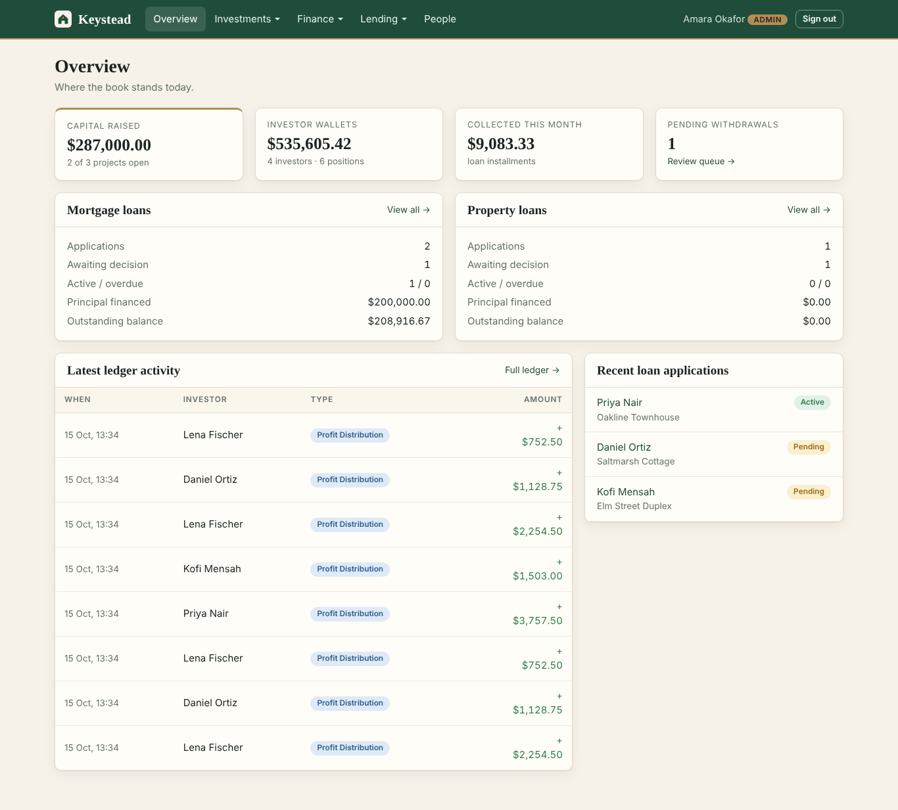
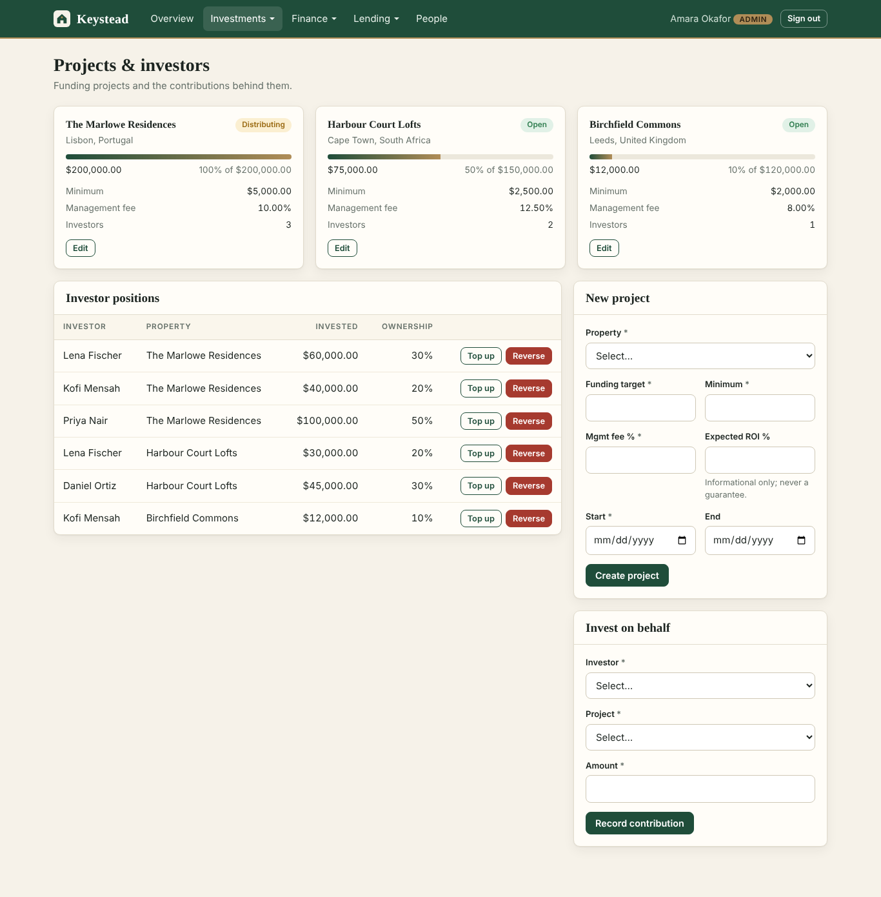
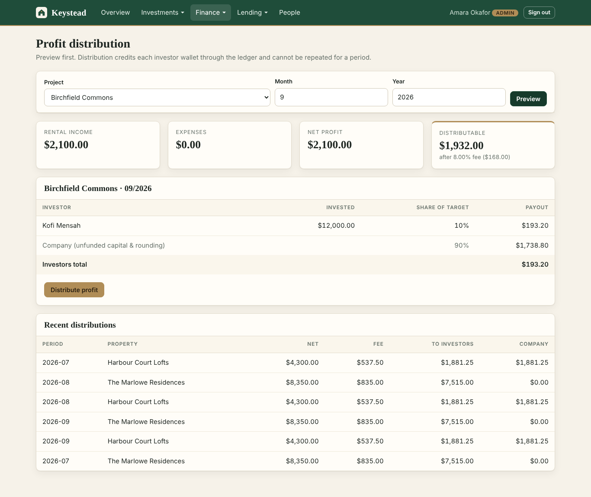
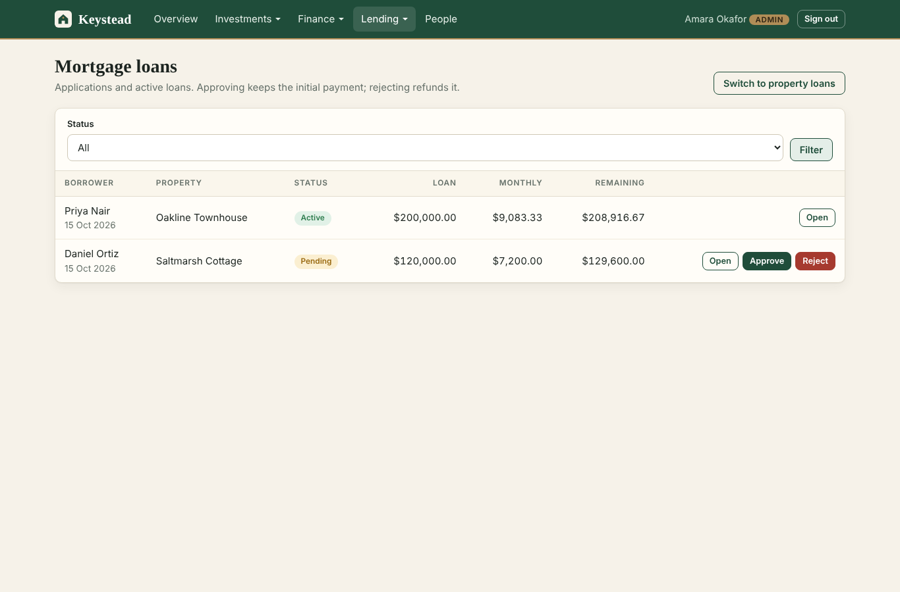
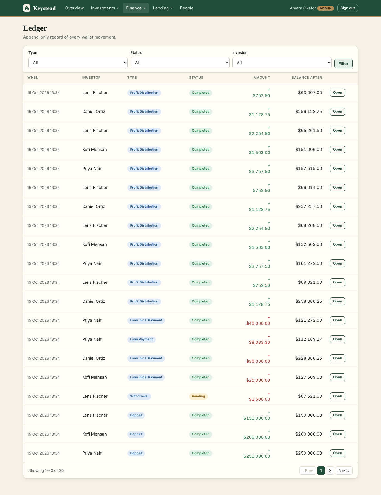
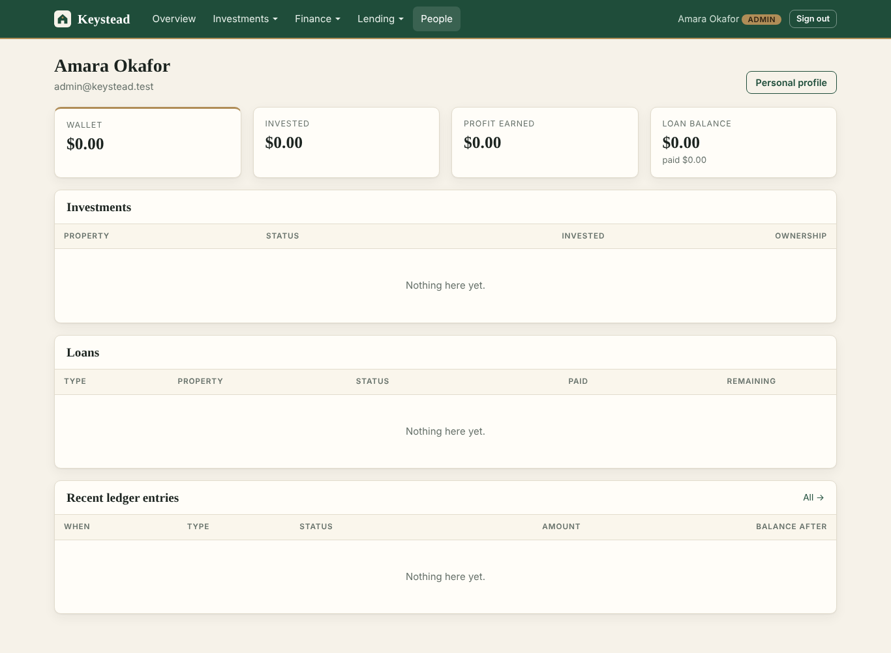
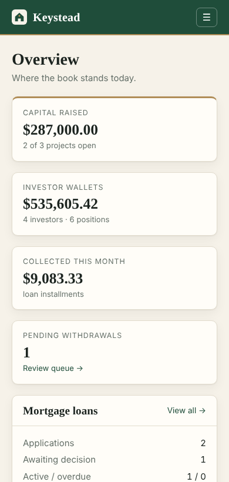
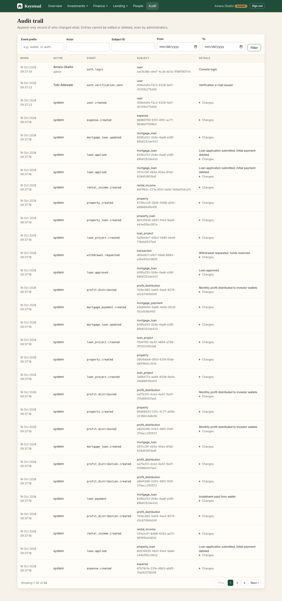
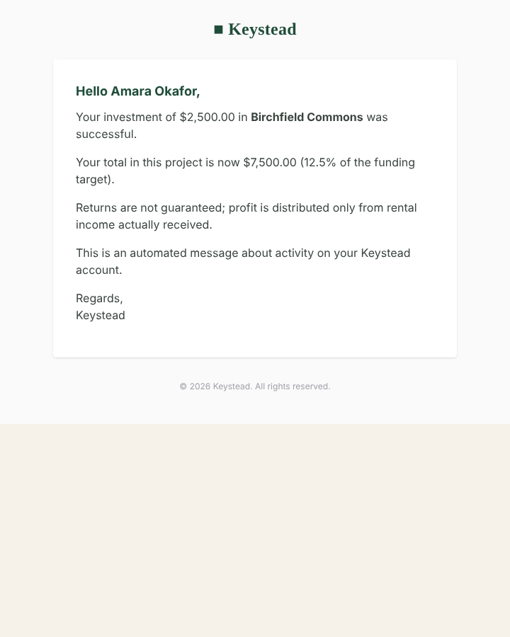
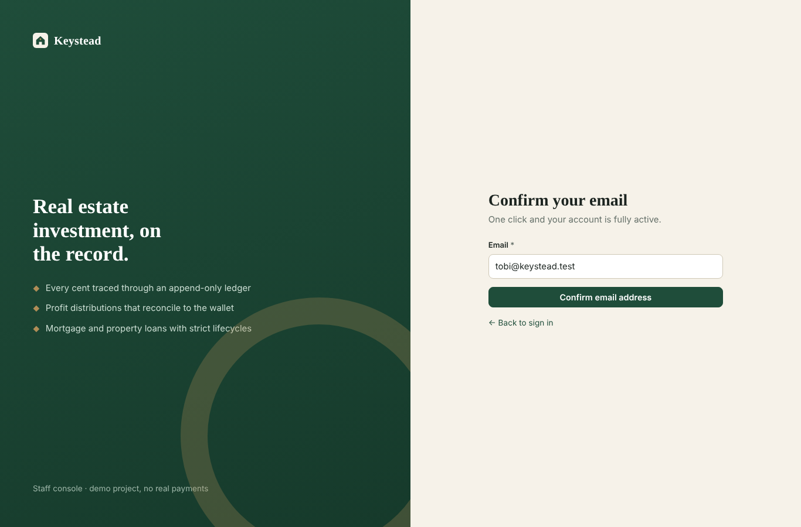

# Keystead — Real Estate Investment & Property Financing Platform

Keystead lets investors pool money into property funding projects and earn monthly rental profit, and lets
borrowers finance a property through mortgage or property loans — all backed by an **append-only wallet ledger**
so every cent can be traced. It ships a **versioned Sanctum REST API** for investors and a **staff console** for
admins and managers.

> Portfolio / demo project. **No real payment processing exists**: wallets are funded by an administrator-recorded
> "manual deposit" ledger entry. Nothing here is investment advice or a return guarantee.



## What it does

| Area | Behaviour |
|---|---|
| **Wallets & ledger** | One wallet per user. Every balance change is a ledger row (`transactions`, with `balance_after`) written in the same DB transaction under a row lock. |
| **Investment projects** | Open → Funded → Distributing → Closed. Minimum ticket, funding target, over-subscription blocked, ownership kept to 4 decimals. |
| **Rental income & expenses** | Recorded per project and month (unique). A period locks once its profit is distributed. |
| **Profit distribution** | `net = income − expenses`, management fee retained, remainder split by share of the funding target (rounded **down** to the cent). Credits wallets and reconciles to the cent. |
| **Withdrawals** | Funds are reserved on request; an admin approves (pays out) or rejects (refund ledger row). One pending request per user. |
| **Mortgage & property loans** | Product → application (exact initial payment) → admin approve/reject → monthly installments from the wallet, one per calendar month, last installment clears the balance exactly. Reject/cancel refunds the initial payment once. |
| **Staff console** | Properties, projects, investors, income/expenses, profit preview & distribution, withdrawals, ledger, loan products and decisions, users. |

## Stack

Laravel 12 · PHP 8.2+ (BCMath) · Sanctum bearer tokens · MySQL/MariaDB (SQLite for tests) · PHPUnit 11 · no frontend build step (hand-written CSS/JS in `public/assets`).

## Quick start

```bash
composer install
cp .env.example .env && php artisan key:generate
# set DB_* in .env (MySQL/MariaDB), or use DB_CONNECTION=sqlite with an empty database/database.sqlite
php artisan migrate --seed                       # roles + countries/states
php artisan db:seed --class=DemoSeeder           # optional demo book (refuses in production)
php artisan serve
```

Demo logins (password `Password123!`, or `DEMO_PASSWORD` from `.env`):

| Role | Email | Use |
|---|---|---|
| Admin | `admin@keystead.test` | Staff console, everything |
| Manager | `manager@keystead.test` | Console, read + day-to-day records (cannot move money) |
| Investor | `lena@keystead.test` (also `kofi@`, `priya@`, `daniel@`) | REST API only |

Console: `http://localhost:8000/login` · API: `http://localhost:8000/api/v1`

```bash
php artisan test                  # 116 tests
php artisan finance:reconcile     # wallet balances vs ledger, distributions vs wallet credits (exit 1 on drift)
php artisan loans:refresh-overdue # also scheduled daily at 01:00
```

## Notifications, verification and audit

* **E-mail verification and account security** – `registration_token` / `password_reset_token` (hashed, expiring, single use); money endpoints require a verified address; password changes and resets sign out other sessions.
* **Notifications** – one `NotificationService`, 17 notification classes. All mail is **sent immediately, never queued** – financial (investments, reversals, withdrawals, profit credits, loans, wallet funding) and security (verify, reset, password changed, account status) alike. No queue worker is required.
* **Audit trail** – append-only `audit_logs` (database triggers + model guards), written in the same transaction as the change; admins browse `/admin/audit`.
* **Ledger integrity** – immutable ledger rows, gapless per-user sequence, non-negative balance constraint, one-time credit dedupe keys, `Idempotency-Key` on money POSTs, extended `finance:reconcile`.

## API at a glance

Everything is under `/api/v1`, JSON only, one envelope: `{ success, message, data?, meta?, links?, errors? }`.
Full reference: [docs/api.md](docs/api.md) · Postman: [docs/keystead.postman_collection.json](docs/keystead.postman_collection.json)

```
POST   auth/register | auth/login | auth/forgot-password | auth/reset-password
GET    auth/me · POST auth/logout · GET/PUT profile
GET    wallet · portfolio · financial-profile · earnings · transactions[/{id}]
GET    withdrawals · POST withdrawals
GET    investment-projects[/{id}[/profit-history]] · GET investments[/summary] · POST investments · GET profit-history
GET    loans/{mortgage|property}/products · GET|POST loans/{type} · GET loans/{type}/{id}
POST   loans/{type}/{id}/payments · POST loans/{type}/{id}/cancel
```

Validation → `422` with field errors · unauthenticated → `401` · suspended → `403` · other people's records → `404` · throttled → `429`.

## Architecture

```
app/
  Http/Controllers/Api/V1   thin controllers (authorize → service → Resource)
  Http/Controllers/Admin    staff console controllers
  Http/Requests/{Api,Admin} Form Requests (validation, money as strings)
  Http/Resources            JsonResources — the only shape money leaves the API in
  Services/                 WalletService · InvestmentService · ProfitDistributionService · LoanService · …
  Policies/                 LoanPolicy · TransactionPolicy (404 for non-owners)
  Enums/                    ProjectStatus · LoanStatus · LoanType · TransactionType …
  Support/Money.php         BCMath decimal-string arithmetic
  Console/Commands/         finance:reconcile · loans:refresh-overdue
```

Design notes: [docs/architecture.md](docs/architecture.md) · money rules: [docs/financial-rules.md](docs/financial-rules.md) · security: [docs/security.md](docs/security.md).

## Verification

* **116 automated tests** (SQLite in-memory, also re-run against MariaDB): money maths, wallet, investments, profit distribution, loans, API contract, authorization, console workflows, demo seeder, e-mail verification and reset tokens, notifications (faked mailer), audit immutability, ledger/DB guards, idempotency and reconcile tamper detection.
* **Concurrency checked on MariaDB** with real parallel processes — `scripts/concurrency-check.sh` (see [docs/security.md](docs/security.md#concurrency)). SQLite cannot prove row locking, so the PHPUnit suite does not claim to.
* The trigger/CHECK guards (audit and ledger immutability, non-negative balance) were exercised with raw SQL on MariaDB 10.11.
* Not covered: real SMTP delivery (mail is asserted with Laravel's fake; the `log`/`array` drivers are used locally), a browser E2E suite, load testing, PostgreSQL, real payment/KYC flows (out of scope by design).

## Screenshots

| | | |
|---|---|---|
|  |  |  |
| Projects & investors | Profit preview | Mortgage loans |
|  |  |  |
| Ledger | Investor financial profile | Mobile |
|  |  |  |
| Audit trail (admin) | Investment e-mail | E-mail confirmation page |

More in [docs/screenshots](docs/screenshots).
